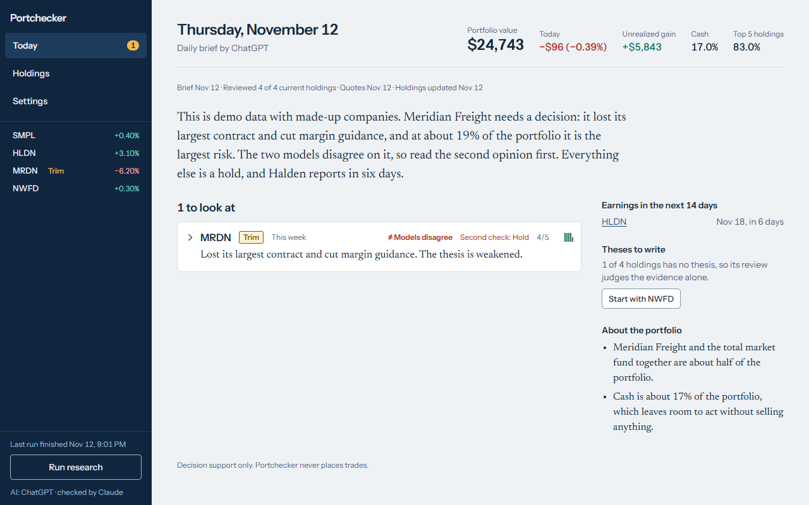
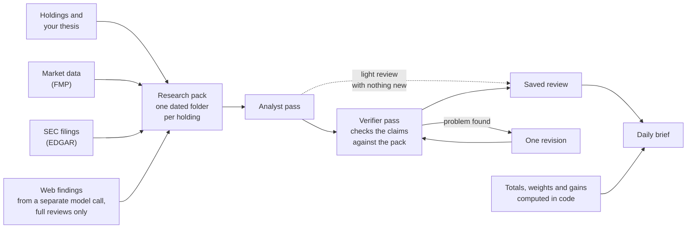
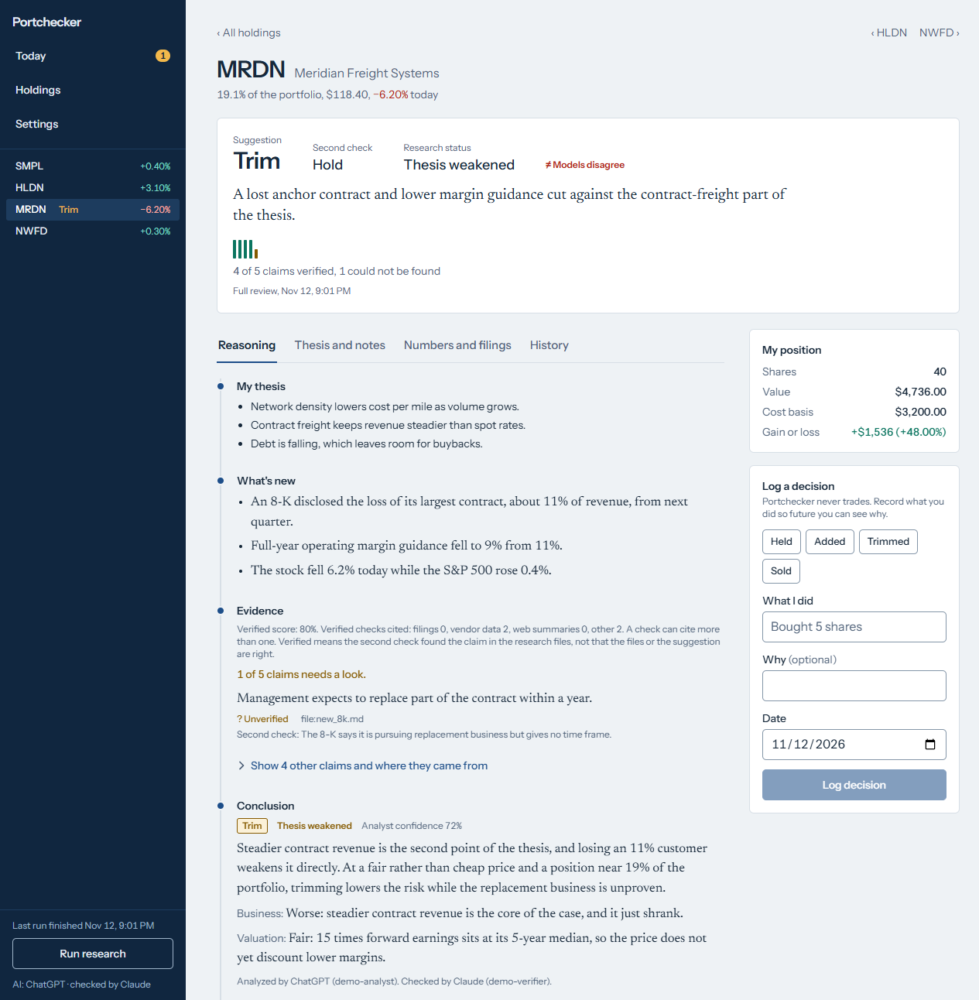

# Portchecker

[](https://github.com/eligorelick/portchecker/actions/workflows/ci.yml)

Portchecker is a local, single-user portfolio research app. It reads your holdings and the thesis you wrote for each one, collects market data and SEC filings, has one AI pass review each stock or fund you hold and a second pass check the claims in that review against the same files, and writes a daily brief. Each holding shows the suggestion, the evidence, what the second check found and what would change the conclusion.

**Decision support only. Portchecker never places trades.** A verified claim means a model matched it to the supplied research material; it does not establish that the source or investment recommendation is correct.



The screenshots show the built-in demo: four made-up investments, cash and a finished brief, loaded with `pnpm demo:seed`. It needs no account and no API key ([try it](#try-the-demo-without-credentials)).

Licensed under [MIT](LICENSE). For development and release guidance, see [CONTRIBUTING.md](CONTRIBUTING.md).

## How it works



1. **Research pack.** For each holding the app writes a dated folder under `data/packs/`. For a light review it holds a copy of your notes and one file with the vendor's figures and your position as computed in code. A full review adds the text it could read from the latest annual and quarterly reports and recent current reports (8-Ks), and web findings with links, gathered by a separate model call.
2. **Analyst.** A model is given that folder, told to take its numbers only from those files, and returns a structured review: an action, the evidence with a source for each claim, its reasoning and what would change its mind.
3. **Verifier.** A second pass gets the same folder plus the review. It marks each claim verified, unverified or contradicted, says whether the conclusion is supported, and gives its own action. In Both mode the other provider does this pass. If that provider's call fails and fallback is on, the check can go back to the provider that wrote the review, and the review then says one provider checked its own work.
4. **One revision.** If the check finds a material problem, the analyst revises once and is checked again. A conclusion the final check does not support stays labelled as rejected. The earlier Current view in your notes is then kept and marked as not updated, and the same happens when a claim is still contradicted after the revision.
5. **Brief.** Portfolio totals, weights, gains and the share of claims verified are computed in code. A model writes the brief around them. Dollar amounts, percentages, decimals and figures given in thousands, millions or billions in its summary, reasons and observations are compared with its inputs; whole numbers without a unit are not. When one cannot be traced, Today shows a general warning and the saved brief file names the figures.

On a quiet day a holding gets a light review instead of a full one. A light review that reports nothing new skips the second check. The holding page then keeps showing the last review that did say something, with its marks, and adds "Nothing new as of" with the time of the light one. A claim that had no second check is labelled "Not checked" ([how to read the labels](#read-the-results-correctly)).



## How correctness is checked

The numbers below were measured on the commit that last changed this section. Re-measure them with the commands shown.

- **1,069 tests in 20 files** run with Node's built-in test runner (`pnpm test`). They need no API key and no provider sign-in: vendor and model answers are supplied by the tests, and the suite passes on a machine with neither. One test, of the ignore rules, is skipped in a copy that is not a git checkout.
- **Coverage is about 93% of branches and 94% of functions** in Node 22's built-in report (`node --test --experimental-test-coverage "src/**/*.test.ts"`). Treat it as a rough guide: the report counts the test files as well as the application, and its line figure for one unchanged file moved enough between two runs to put the total at 93.2% in one and 94.1% in the other.
- **About 27,700 lines of tests for about 17,300 lines of application code**, counted over the tracked files in `src/` and `scripts/`.
- **The suite passes with the clock in `UTC`, `Asia/Tokyo` and `America/Los_Angeles`.** The app sets the computer's calendar beside US market dates, so the same tests are run in each zone.
- **Continuous integration** runs typecheck, lint with zero warnings allowed, the format check, the tests and a production build on Ubuntu and Windows with Node 22 ([workflow](.github/workflows/ci.yml)).
- **Fixes carry their evidence.** Since commit `85e803a`, a fix to behaviour is committed with a test that fails without it or, where a test cannot show it, a before-and-after check on a built server or in a browser. Each such commit message says what was wrong and how the fix was shown to work.

These checks have limits, listed with the others under [Known limits](#privacy-cost-and-limitations): the tests supply the vendor and model answers themselves, so they check the code around the models and not the quality of a model's research, and a real Schwab export has not been validated end to end.

## Design decisions

- **Portfolio figures come from code, not from the model.** Position values, weights, gains and concentration are computed from holdings and quotes, and the verified score is counted in code from the checker's verdicts; the model is handed the portfolio figures and told to trust them. The cost is that a wrong vendor figure flows straight through, so the app cross-checks some vendor rows against each other and says so in the pack when they do not add up.
- **A second pass checks the first and may disagree.** Its verdicts and its own action are shown beside the analyst's, and a rejected conclusion is not allowed to replace your saved Current view. The cost is one more model call for every full review and for any light review that reports a change, and two more when it revises. The checker also reads the analyst's review first, so it is a check of that review, not a blind second opinion.
- **Unknown stays unknown.** A holding with no price is named and left out of the totals instead of being valued at zero, a missing cost basis gives no gain, and an imported number in a form the reader does not recognise is left blank. The cost is totals that can be partial; the pages say which holdings were left out.
- **Full reviews only when something changed.** A new annual, quarterly or current report, a move above 5% in a day or 10% in five sessions, a changed thesis or seven days since the last one triggers a full review; otherwise the review is light. That keeps model usage down, and it means a slow change with no filing and no large move waits up to a week.
- **Local files and no login.** Holdings, research and briefs live in one SQLite file and plain files under `data/`, so with the app stopped a backup is a copy of that folder and `.env`, plus the database file if `DATABASE_PATH` points somewhere else. The cost is a single user on a trusted machine: the request checks in [SECURITY.md](SECURITY.md) are not authentication, and the AI calls still send your notes and holdings to the provider you choose, or to the other one when fallback moves a call.

## What you can do

- Review changes and unresolved calls on **Today**.
- Track positions, cash, gains and concentration on **Holdings**.
- Inspect each holding's reasoning, evidence, financial data, filings and review history.
- Keep your own thesis and break conditions alongside the model's current view.
- Import a Schwab Positions CSV, review screenshots with AI assistance, or edit holdings manually.
- Run research on demand or schedule the command on your computer.

The app stores data locally in SQLite and Markdown files. AI processing uses external providers. It has **no authentication** and is intended for one user on a trusted machine, not a public web deployment. Read [SECURITY.md](SECURITY.md) before connecting accounts or adding real holdings, including the documented Codex file-access limitation.

## Requirements

- **Node.js 22.18 or newer** and **pnpm 12.16.1**, as recorded in `package.json`.
- A separate, writable project directory. On Windows, keep it outside `AppData\Local\Temp`; the tested Codex sandbox could not start processes there. Keep its path short as well: `pnpm dev` failed with "Module not found" from a project folder whose path was 122 characters long and worked from one of 113, while `pnpm build` and `pnpm start` worked from both.
- For real research: Financial Modeling Prep access, a name/email for the SEC request identity, and at least one AI provider below. The app has been tested with FMP Starter; endpoint availability depends on your plan.

The automated checks run on Linux and Windows. Research runs with real providers have been made only on Windows, macOS is untested, and the Linux/macOS scheduling examples below have not been run.

Download or clone the source, open a terminal in the project root, then install:

```sh
npm install -g pnpm@12.16.1
pnpm install --frozen-lockfile
```

## Try the demo without credentials

Use a fresh copy of the project, separate from any real installation. After installing dependencies:

```sh
pnpm db:push
pnpm demo:seed
pnpm dev
```

Open <http://localhost:3000>. The demo creates four fictional investments, cash and a completed research brief. Seeding does not call market-data providers or models. Explore Today, Holdings and the individual holding pages; running new research, provider tests, thesis drafting or Ask requires real setup and can consume provider usage.

The seed command refuses an installation that already contains records or saved data files. Keep the demo separate from your real portfolio. Changing `DATABASE_PATH` alone does not isolate dossiers, packs, imports and briefs, which remain under the working directory's `data/` folder.

## Set up your own portfolio

### 1. Configure the environment

Use a fresh installation rather than converting the demo in place. Copy `.env.example` to `.env` in the project root and enter your values:

```dotenv
FMP_API_KEY=your-fmp-key
SEC_USER_AGENT="Your Name you@example.com"
DATABASE_PATH=./data/portfolio.db
ANTHROPIC_API_KEY=
```

Replace the sample name/email with your own request identity. The app treats an `example.com` SEC contact as unset and stops research until it is replaced. `ANTHROPIC_API_KEY` is optional if you use ChatGPT or Claude subscription access; API users can save it in Settings instead. A saved value takes precedence over the environment value. Restart the app after changing `.env`.

Do not commit `.env`, your database or `data/`. Credentials saved in Settings are stored as plain text in the local database; protect the files and backups accordingly.

### 2. Set up an AI provider

| Option                | Setup                                                                                                                                                                                                   | Usage                                                                                      |
| --------------------- | ------------------------------------------------------------------------------------------------------------------------------------------------------------------------------------------------------- | ------------------------------------------------------------------------------------------ |
| ChatGPT through Codex | Install with `npm install -g @openai/codex`, run `codex login`, and sign in with ChatGPT.                                                                                                               | Uses the signed-in plan's limits; no OpenAI API key is required by Portchecker.            |
| Claude subscription   | Follow the [Claude Code installation guide](https://code.claude.com/docs/en/setup), run `claude auth login`, and choose subscription sign-in. Select **Claude subscription (Claude Code)** in Settings. | Uses subscription limits. Claude Code's extra-usage settings can allow additional charges. |
| Anthropic API         | Select **Anthropic API** in Settings and enter an API key there or in `.env`.                                                                                                                           | Billed separately for API usage.                                                           |
| Both                  | Configure ChatGPT and one Claude access option, then choose which provider analyzes and which checks.                                                                                                   | Consumes usage from both providers.                                                        |

Run sign-in commands as the same operating-system user that will run Portchecker. Keep `node`, `pnpm` and any selected provider CLI on the app's and scheduler's `PATH`.

In single-provider mode, the same provider performs analysis and verification. In Both mode, the other provider performs the second check. Claude subscription mode does not use a saved API key or switch to API authentication when a subscription limit is reached.

### 3. Initialize and start

From the project root:

```sh
pnpm db:push
pnpm build
pnpm start
```

Open <http://localhost:3000>. `pnpm start` serves the production build; keep its terminal/process running while using the app. For development, use `pnpm dev` instead of the build/start pair. Both start commands bind to `127.0.0.1` by default.

In **Settings**, select the provider mode, model and effort. Decide whether to enable **If one fails, use the other**, then save changes. Each provider's **Test** button makes a real model call using the saved settings; use it to confirm setup before a full run.

Fallback is enabled by default. If another provider is configured, a failed call can be retried there, sharing the same research context and consuming that provider's usage. Turn fallback off if you do not want this behavior.

### 4. Add and check holdings

Open **Holdings → Update holdings**.

- **CSV:** export Positions from Schwab and choose the CSV file. Parsing is local. Review every preview row, skipped-row notice, account label and cost-basis warning before confirming.
- **Screenshots:** upload up to 12 images. AI extracts the positions before you confirm them, so crop out account identifiers and check every extracted value. Images are sent to the selected provider, or to the other one if that call fails and fallback is on, and are retained locally even if you cancel the preview.
- **Manual entry:** add or edit individual rows. Enter **total cost basis**, not cost per share. Leave an unknown basis blank; zero is a real value. Keep account labels distinct when holding the same ticker in multiple accounts.

**File import replaces the current holdings list.** Positions missing from the confirmed preview will be removed from that list; it is not an append operation. Use manual entry for a small change. Preview deletions and changed quantities carefully before choosing **Replace my holdings**.

For cash and money-market balances, use ticker `CASH` and enter the dollar balance as the quantity. For example, $1,250 in cash is quantity `1250`. Portfolio amounts are displayed in US dollars; the app does not perform portfolio currency conversion. Use USD-valued positions and USD cost basis.

### 5. Run research and record your thesis

1. Press **Run research** in the sidebar. Watch its status and review any failed/skipped holdings. A first run performs full reviews and can take substantial time, especially with many holdings or high effort settings.
2. Open **Today** for the brief. Check its date, quote dates, coverage and warnings before acting.
3. Open each holding's **Thesis and notes** tab. Write why you own it and measurable conditions that would break that thesis, then save. After an initial run, **Draft a thesis for me** can help; it is a real model call, and you must review the draft before saving it as your thesis.
4. Run research again when you want saved thesis changes evaluated. Saving a thesis requests a full review; it does not rewrite the previous review automatically.
5. Read the evidence and second opinion, then use **Log a decision** to record what you chose. Logging is a journal entry: it neither executes a trade nor updates your share count. Update holdings after making a real trade.

The job may update the dossier's **Current view** after a successful final check. It does not replace your thesis or other owner-written sections. Without a saved thesis, reviews judge the available evidence without knowing your personal reasons for owning the holding.

Use **Ask about this holding**, on the Reasoning tab of a holding page, for follow-up questions about its saved research files. This makes a model call; it does not refresh the market data or run a new review. Answers are shown on the page but are not stored, so copy anything you want to keep into your notes.

## Read the results correctly

Later runs choose a full review when a qualifying filing arrives, a new large price move warrants it, the previous full review is old, or you have changed your thesis. Otherwise they use a light review. A large move is more than 5% in a day or more than 10% over five trading days, measured on the holding's own price and not against the market, and a full review is due once the last one is more than seven days old. A quiet light review can skip the second check; it must not be read as a newly verified conclusion. When a check finds a material problem, the job can revise once and check again. Unresolved concerns stay visible.

| Label                 | Meaning                                                                                                                                                               |
| --------------------- | --------------------------------------------------------------------------------------------------------------------------------------------------------------------- |
| Verified              | The second check matched a claim to the supplied research material.                                                                                                   |
| Unverified            | The claim could not be confirmed from that material. It is not necessarily false.                                                                                     |
| Contradicted          | The second check found material that conflicts with the claim.                                                                                                        |
| Not checked           | No second check was performed, as can happen on a quiet light review, or the second check did not cover that claim.                                                   |
| Verified score        | The share of displayed evidence/check claims marked verified. It is not a probability of investment success.                                                          |
| Models agree/disagree | Whether the analyst's and the checker's action judgments agree, shown when two different providers did the two passes. Agreement does not guarantee factual accuracy. |
| Final check rejected  | The final check did not support the conclusion. Read the concerns before using the recommendation.                                                                    |
| Review                | The holding needs attention; it is not an instruction to trade.                                                                                                       |

With one provider doing both passes, a disagreement reads "Second check disagrees" and agreement shows no label. A claim that is still contradicted while the final check supports the conclusion does not show "Final check rejected": it appears on the holding page as a "contradicted" count beside the proof marks and as "Contradicted" on the claim, and the holding is listed on Today.

An unpriced holding is named and omitted from totals, not valued at zero. Missing cost basis limits gain calculations. A stale brief, partial run or missing filing warning limits what was checked. A quiet brief is not a guarantee that the portfolio is safe.

Web findings are model-written summaries with links. A verified web claim means the saved findings support it; inspect the original source when the claim matters to your decision. Claude API mode receives selected, shortened filing text, so a true claim may remain unverified when the relevant passage was not included.

## Run research on a schedule

Research runs when you press the button or invoke the command; the app does not install a scheduler for you. From the project root:

```sh
pnpm research
```

To review specific holdings without replacing the portfolio-wide brief:

```sh
pnpm research AAPL MSFT
```

Schedule the full command only after a manual run succeeds. Use the same user and provider sign-ins, set the working directory to the project root, and ensure `node`, `pnpm` and the provider CLIs are on `PATH`. Do not overlap jobs. The computer must be awake and able to reach the providers.

**Windows Task Scheduler:** create a task under your user account with a weekday trigger. Use `cmd.exe` as the program, `/d /c pnpm research > data\scheduled-run.log 2>&1` as the arguments, and the full project directory in **Start in**. Choose **Run only when user is logged on** when using desktop notifications. Use full executable paths if the task cannot find your tools. Test the task manually and inspect its log before relying on the schedule.

**Linux/macOS cron:** this example runs at 07:00 on weekdays in the scheduler's local time:

```cron
0 7 * * 1-5 cd "/path/to/portchecker" && pnpm research > data/scheduled-run.log 2>&1
```

Cron does not load your normal shell profile. Set its `PATH` to include the required tools, and replace the example directory. On macOS you can instead configure a user launchd agent with the same command and working directory. Desktop notifications depend on the operating system and session; use the saved log and app status to check completion.

## Privacy, cost and limitations

**Local storage does not mean local AI.** Research, thesis drafting and Ask can send your notes, holdings and research context to OpenAI through Codex or to Anthropic. Brief generation includes portfolio totals. Screenshot extraction sends the entire image. Fallback can send the same context to another provider. CSV parsing stays local; market-data requests still identify the requested tickers to FMP, and SEC requests include your configured contact identity. `pnpm build` and `pnpm dev` download the app's two typefaces from Google Fonts; the running app then serves its own copies.

FMP access and AI usage are separate. Subscription calls use plan limits and may be affected by the provider's extra-usage settings; API calls are billed separately. Full reviews, web research, revisions, provider tests and fallback all consume usage. Settings shows the Claude token and web-search counts recorded for the last research run, which is not a complete bill or a price guarantee. ChatGPT usage is not recorded. Check your providers' current terms and rates before running a large portfolio.

Known limits:

- Vendor figures and model conclusions can be wrong despite the checks.
- Some filings or exhibits cannot be read; some funds lack filings, holdings or sector breakdowns.
- Splits, ADR ratios, currency conversion and cost-basis reconciliation require your own checks.
- There are no owner-defined target weights, so add/trim suggestions do not implement a personal allocation plan.
- The app's own figures have a fixed scope. It computes no comparison with peer companies; no correlation, beta or factor exposure across holdings; no overlap between a stock you hold directly and the same stock inside a fund; no tax on a sale and no holding period; no measures specific to real-estate trusts, such as FFO; and no trend in share count, stock-based pay, buybacks, debt maturities or analyst estimates. Valuation is compared with the company's own history, and the S&P 500 fund SPY is the only benchmark. A review covers these topics only as far as the model finds them in filings or web results.
- Dates follow the computer's time zone. East of roughly UTC+3, a US closing quote can show the next calendar day.
- The automated tests supply the vendor and model answers themselves. They check the code around the models, not the quality of a model's research, and no test calls a real provider.
- CSV tests cover fixtures and screenshot-derived data; a real Schwab export has not yet been validated end to end.
- The requested Codex file deny list is **not a verified isolation boundary on the tested Windows installation**. Do not assume a model is confined to its research pack or that all local secrets are protected.

See [SECURITY.md](SECURITY.md) for provider data sharing, plain-text credential storage and the limits of the CLI controls. Portchecker should not be exposed to the public internet.

## Data, backups and updates

| Location                  | Contents                                                                                      |
| ------------------------- | --------------------------------------------------------------------------------------------- |
| `data/portfolio.db`       | Default SQLite database: holdings, settings, decisions and research history.                  |
| `data/dossiers/TICKER.md` | Your thesis, notes and the model's current view.                                              |
| `data/briefs/`            | Saved daily briefs.                                                                           |
| `data/packs/`             | Dated research inputs, extracted sections, full filing text when available and model outputs. |
| `data/imports/`           | Imported CSVs and screenshots.                                                                |
| `data/last-run.log`       | Output of the most recent sidebar-started research run.                                       |
| `data/scheduled-run.log`  | Output if you use the scheduling examples above.                                              |

`DATABASE_PATH` changes the database location only. `pnpm build` opens the database, so it creates an empty database there if none exists; `pnpm db:push` creates the tables. Other data files remain relative to the directory from which the app or script runs. Use the project root consistently. There is no automatic pruning of research packs or imports.

**Back up:** stop the app and all research jobs, then back up the entire `data/` folder, including database `-wal` and `-shm` companions. Include a custom database location if configured, and keep `.env` in a protected backup. Dossiers alone are not a complete backup.

**Restore:** stop the app and jobs, preserve the current data separately, then restore the complete backup, custom database path and environment configuration together.

**Update:** stop the app and jobs, make a backup, and replace the code while preserving your data and environment file. Then run:

```sh
pnpm install --frozen-lockfile
pnpm db:push
pnpm build
pnpm start
```

Read and review any schema-change prompt before accepting it. Do not build over a directory serving a running production app. Without a new build, the browser can serve old code while the research command uses the updated source. See [CONTRIBUTING.md](CONTRIBUTING.md) for verifying changes in an isolated copy.

## Commands

| Command                                                            | Purpose                                                                   |
| ------------------------------------------------------------------ | ------------------------------------------------------------------------- |
| `pnpm dev`                                                         | Start the development server on loopback.                                 |
| `pnpm build` / `pnpm start`                                        | Build and serve the production app.                                       |
| `pnpm research [TICKER...]`                                        | Run one research job; optional tickers keep the existing portfolio brief. |
| `pnpm pack:ticker AAPL`                                            | Build a research pack; contacts data vendors but does not call a model.   |
| `pnpm demo:seed`                                                   | Seed a separate empty installation with fictional data.                   |
| `pnpm db:push`                                                     | Initialize or update the database schema.                                 |
| `pnpm typecheck` / `pnpm lint` / `pnpm format:check` / `pnpm test` | Run development checks; follow the isolation rules in CONTRIBUTING.       |

## Troubleshooting

- **Missing FMP or SEC setup:** check the values in your local environment configuration, replace placeholder contact details, and restart the app.
- **Codex missing or not signed in:** install `@openai/codex`, confirm it is on the app's `PATH`, run `codex login`, and check `codex login status` as the same user.
- **Claude subscription not ready:** use native `claude auth login`, choose subscription access, and recheck sign-in in Settings. An API key does not satisfy subscription readiness.
- **A provider test uses old settings:** save changes first, then test again. Tests use persisted settings.
- **Another research run is in progress:** let the active run finish. A crashed run becomes reclaimable after its heartbeat is stale for ten minutes; do not start competing processes to bypass the guard.
- **A filing could not be read:** inspect the warning. Temporary failures can be retried; a PDF/image exhibit that the app cannot extract remains explicitly unread. A review may proceed with incomplete source material.
- **An unpriced holding or missing gains:** check the ticker, quote date and total cost basis. Missing values are not automatically zero.
- **403 response:** open the app at `localhost` or `127.0.0.1` on the machine running it, in its own tab rather than from another site's page. Hostnames added through `ALLOWED_HOSTS` do not add authentication; review SECURITY before changing network access.
- **A scheduled job fails but manual research works:** check its operating-system user, working directory, `PATH`, provider sign-ins and `data/scheduled-run.log`.
- **Changes do not appear:** `pnpm start` serves the previous build until you stop it, rebuild and restart. A browser can also retain an older tab icon until refreshed.

## Contributing and release

See [CONTRIBUTING.md](CONTRIBUTING.md) for offline verification and release checks, and [SECURITY.md](SECURITY.md) for the security model. Report reproducible issues with fictional or redacted inputs; do not attach real portfolios, screenshots, research packs or credentials.

If you share a copy, share the tracked source (a clone or `git archive`) and read its file list first, not your working directory: `.env`, `data/`, databases, logs and backups are ignored by git but would be included in a folder copy. Portchecker is available under the [MIT license](LICENSE).
